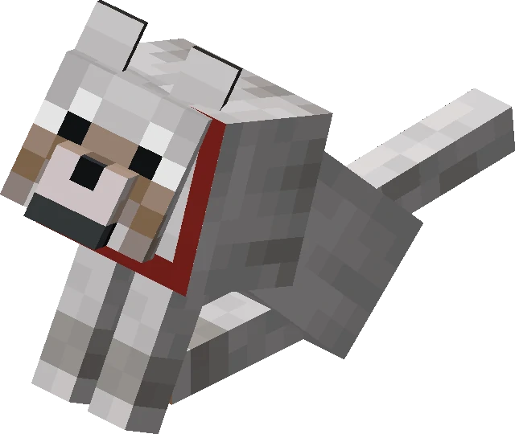

# pr-watchdog-assets

PR 워치독([pinion05](https://github.com/pinion05)의 PR 감시 자동화)이 코멘트·리포트에 삽입하는 이미지 등 정적 에셋을 호스팅하는 전용 리포입니다. 코드는 포함하지 않으며, GitHub raw URL(`https://raw.githubusercontent.com/pinion05/pr-watchdog-assets/main/<파일명>`)을 통해 워치독이 남기는 코멘트 마크다운에서 직접 참조됩니다.

## 에셋 목록

| 파일 | 설명 | 사용 예시 |
| --- | --- | --- |
| [`sniffing.webp`](sniffing.webp) | 워치독이 PR을 "냄새 맡는(sniffing)" 중임을 나타내는 이미지. 리뷰 대기·분석 진행 상황을 알리는 코멘트에 사용 | `` |

미리보기:

## 에셋 추가 방법

에셋을 추가할 때는 파일을 리포 루트에 커밋한 뒤(용량이 크지 않은 webp·png·gif 등 웹 친화적 포맷 권장, 파일명은 용도를 알 수 있게 스네이크 케이스로), main 브랜치에 반영하고 위 표에 한 줄을 추가하세요. 에셋은 곧바로 `https://raw.githubusercontent.com/pinion05/pr-watchdog-assets/main/<파일명>` URL로 접근 가능하므로, 워치독 코멘트 템플릿에서 이 URL을 참조하도록 수정하면 됩니다.
